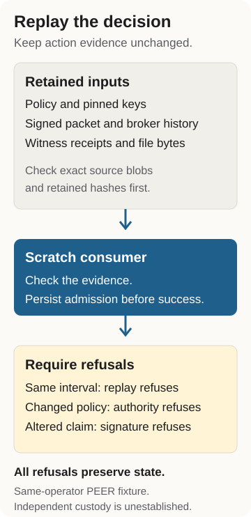

# Replay an agent evidence decision without replaying the action

A file changed. A consumer accepted its evidence. What happens when someone submits that same evidence again, changes the expected authority, or alters the signed claim? Replay this retained example to inspect each decision.

The [preview image](assets/admission-social.png) has an [editable SVG](assets/admission-social.svg) and [source and export instructions](assets/README.md).

The [presentation packet](experiments/observer-admission/README.md) joins this article, the images, exact retained inputs and recorded result.

The example uses [Observer](start.md#observer) and an original public CI bundle. Its checker reads the policy, signed packet, broker history, witness receipts and durable file. It recreates the consumer decision in a scratch store. It does not repeat the file action in the retained workspace.

<figure>

<figcaption aria-hidden="true">The consumer checks the retained policy, signed packet, broker history, witness receipts and durable file. It stores the first admission. Replay, changed authority and changed signed bytes refuse without changing consumer state.</figcaption>
</figure>

<a id="read-the-evidence-before-the-verdict"></a>

## Read the evidence before the verdict

Start with these files. Each link opens the actual retained bytes.

| Question | Evidence |
|----|----|
| What did the consumer expect? | [Policy](experiments/observer-admission/retained/consumer/policy.json) |
| What claim was signed? | [Packet](experiments/observer-admission/retained/producer/packet.json) |
| What did the broker record? | [History](experiments/observer-admission/retained/producer/history.jsonl) |
| Which checkpoint receipts survived? | [Witness log](experiments/observer-admission/retained/producer/ledger.jsonl) |
| Which file bytes survived? | [Durable file](experiments/observer-admission/retained/producer/workspace/result.txt) |
| What did the consumer persist? | [Decision](experiments/observer-admission/retained/consumer/decision.json) and [state](experiments/observer-admission/retained/consumer/state.json) |

The [provenance manifest](experiments/observer-admission/provenance.json) binds these files to their retained hashes. The [source pins](experiments/observer-admission/source-pins.json) bind every imported Observer source to its Git blob. The runner checks both before it evaluates the evidence.

<a id="run-the-retained-example"></a>

## Run the retained example

Use Linux with Git and [uv](https://docs.astral.sh/uv/getting-started/installation/). The command selects the exact runtime and source for the historical experiment. It does not advertise that older source as the current Observer install.

``` sh
git clone https://github.com/probityai/agent-evidence/tree/main/site atlas-replay
cd atlas-replay
git checkout --detach 57d0085723c9eee1400797acf6729c4204325451
git clone https://github.com/probityai/probity/tree/main/packages/observer observer-source
git -C observer-source checkout --detach 8562c25fb7ec97596ea9d0297c495340298914b6
uv run --no-project --python 3.12.14 --with cryptography==46.0.7 \
  python experiments/observer-admission/run.py \
  --observer-root observer-source \
  --bundle experiments/observer-admission/retained \
  --manifest experiments/observer-admission/provenance.json \
  --expect experiments/observer-admission/recorded.json > replay.json
python3 - <<'PY'
import json

with open("replay.json", encoding="utf-8") as stream:
    outcomes = json.load(stream)["outcomes"]
for name in ("admissionStatus", "replayRefusal", "authorityRefusal",
             "tamperRefusal", "refusalsPreserveState"):
    print(f"{name}: {outcomes[name]}")
PY
```

The successful replay exits with code zero. The selected output is:

``` text
admissionStatus: admitted
replayRefusal: interval was already admitted by this consumer
authorityRefusal: packet authority differs from consumer policy
tamperRefusal: signature does not verify under the pinned key
refusalsPreserveState: True
```

The full `replay.json` also includes the checked source hashes, effect hash, coverage declaration and witness scope. `--expect` compares the complete report with the [recorded result](experiments/observer-admission/recorded.json). A wrong source, changed retained file, unexpected decision or different refusal fails the command. Inspect stderr and its exit code before reading any output as a pass. Keep the retained bundle unchanged.

<a id="why-each-refusal-matters"></a>

## Why each refusal matters

**Replay.** The consumer stores its first admission before returning success. Submitting the same interval again refuses. Replay protection depends on that consumer state. Deleting or rolling it back can erase the protection.

**Authority.** The checker changes the expected scope from `/work` to `/other`. It uses a fresh store so replay protection cannot hide a missing authority check. The unchanged packet refuses against the changed policy.

**Signed bytes.** The checker changes `afterRoot` in the claim without signing it again. Another fresh store checks the altered packet against the pinned key. The signature check refuses it. A carried key does not become trusted because it appears beside a packet.

Every control compares consumer state before and after the refusal. A refusal that changes the store would fail this example too.

<a id="keep-the-result-within-its-scope"></a>

## Keep the result within its scope

This is an author-produced same-operator fixture. Its witness scope is `PEER`. The public keys and witness head are fixture pins. The example checks retained bytes, local admission and the declared broker-write population. It does not establish independent custody, complete effect capture or exactly-once downstream effects. The current workspace bytes cannot reveal every transient action that happened earlier.

Read the [original experiment](experiments.md#observer-consumer-admission) for the complete method, original CI provenance and limits. Its existing [claim-ledger rows](claims.md#experiments) remain the evidence for those results.

The essay [*Independent AI evaluators need evidence they can verify*](https://thepragmaticquant.com/independent-evaluators-need-something-to-verify/) (October 14, 2026) uses this replay as its last example. It argues that a buyer should name in advance the records an agent action will be judged by, and that a missing record should never read as success.

<a id="use-the-next-tool-for-your-task"></a>

## Use the next tool for your task

Use [Verify](start.md#verify) to check a supplied claim against supported retained artifacts. Use [Vectors](start.md#vectors) to test a verifier against known accepted and rejected inputs. Use [Admission](start.md#admission) to apply evidence requirements to a workload policy.

To publish an actual operated run, follow the [Open Evidence Lab](lab.md) submission route. Preserve who built the checker, who ran it, who reviewed it and which host actually depends on it. A replay of this fixture does not fill those separate roles.

[HTML view](replay-an-evidence-decision.html) | [Agent guide](llms.txt)
